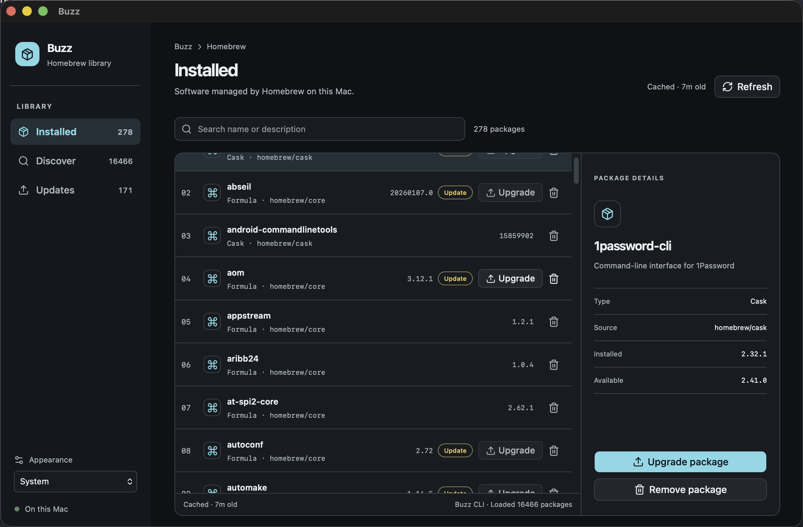

<div align="center">

# Buzz

### Homebrew, with a clearer view.

Manage Homebrew formulae and casks from a native macOS desktop app or terminal.

[](https://www.apple.com/macos/)
[](https://go.dev/)
[](https://wails.io/)
[](LICENSE)

</div>

<p align="center">
  
</p>

Buzz brings your Homebrew library into one focused interface. Browse installed and available packages, check versions and updates, then install, upgrade, or remove supported packages. The desktop app uses a bundled Buzz CLI, so Homebrew operations stay in Go and the UI stays focused on your package state.

## What you can do

- **See what is installed** — Browse formulae and casks managed by Homebrew.
- **Find packages** — Search the available Homebrew catalog.
- **Manage packages** — Install, upgrade, and remove supported packages.
- **Review updates** — Compare installed and available versions.
- **Use cached data** — See cache freshness and refresh the catalog when you choose.
- **Choose an appearance** — Follow System, Light, or Dark mode.
- **Use the terminal** — Keep the Buzz CLI and its interactive terminal UI.

## Get started

### Run the desktop app from source

Requirements: macOS, Go 1.25.6+, Node.js 22+, pnpm 10+, Homebrew, and Xcode Command Line Tools.

```sh
pnpm setup:wails
pnpm install
pnpm dev
```

Build the macOS app bundle:

```sh
pnpm build
```

The bundle is written to `apps/desktop/bin/Buzz.app`.

### Build and run the CLI

Requirements: macOS, Go 1.24.4+, Homebrew, and a terminal with a Nerd Font for the interactive UI.

```sh
make
./buzz
```

`make` also creates `./taproom` as a compatibility executable. Both names launch the same terminal UI.

## CLI JSON streaming

Buzz CLI supports a versioned JSON Lines protocol for the desktop app and automation. Package data streams on stdout; diagnostics go to stderr.

```sh
./buzz --stream-json list
./buzz --stream-json installed
./buzz --stream-json refresh
./buzz --stream-json install ripgrep
./buzz --stream-json upgrade ripgrep
./buzz --stream-json uninstall ripgrep
./buzz --stream-json install firefox --cask
```

Supported operations: `list`, `installed`, `refresh`, `install`, `upgrade`, and `uninstall`. The legacy `--machine handshake` command remains available for compatibility.

## How it fits together

```text
apps/
  cli/          Go terminal app and bundled app-facing executable
  desktop/      Wails shell and React + shadcn/ui frontend
modules/
  brew/         Homebrew catalog and package operations
  gh/           GitHub functions
  protocol/     Versioned JSON Lines messages
```

The desktop frontend presents package data and progress. Buzz CLI coordinates operations through function modules; Homebrew remains the source of package state.

## Project status

Buzz is under active development. The desktop shell, installed package view, package details, search, appearance settings, and CLI streaming integration are in the repository. The [RFC roadmap](.spec/ROADMAP.md) tracks planned and approved work.

## Contributing

Start with the [RFC roadmap](.spec/ROADMAP.md) and the individual RFC linked there. Keep changes scoped to the relevant app or function module. Run the checks for the area you change before submitting a pull request.

## Automated releases

Push a `feature/*` branch and wait for `CI` to pass; the workflow then opens or reuses its PR into `develop`. After feature PRs merge, Release Please opens one version and changelog PR. Merging that PR triggers a `develop` → `main` promotion PR. Once the promotion merges and `Verify` passes, Buzz tags that exact commit, builds and notarizes arm64 and Intel DMGs, publishes the GitHub Release, then opens a Cask PR to `systembugtj/luban-homebrew:develop`.

Configure these fine-grained PATs as Actions secrets before enabling the automation: `FEATURE_PR_TOKEN` (Pull requests: write on `commandotj/ax-buzz`), `RELEASE_BOT_TOKEN` (Contents, Issues, and Pull requests: write on `commandotj/ax-buzz`), and `HOMEBREW_CASK_TOKEN` (Contents and Pull requests: write on `systembugtj/luban-homebrew`). Keep Apple signing and notarization credentials in the existing `release` environment. The first feature PR is a one-time manual bootstrap because GitHub only runs `workflow_run` listeners present on the default branch.

For a failed release after its version tag exists, open **Actions → Buzz.app release → Run workflow** and select that existing `vX.Y.Z` tag as the workflow ref. The workflow rebuilds that immutable commit; it never moves or replaces a tag.

## License and origin

See [LICENSE](LICENSE) for license terms. Buzz CLI's terminal UI derives from [Taproom](https://github.com/hzqtc/taproom); the `taproom` executable and legacy settings remain for compatibility.
